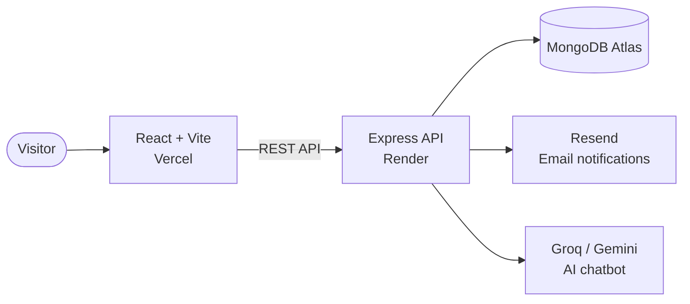

 

 

## 01 &nbsp;/&nbsp; Recruiter Snapshot

> **The 10-second version.** Everything you need to decide if we should talk.

| | |
| :-- | :-- |
| **Role** | Full-Stack Developer |
| **Location** | West Bengal, India |
| **Open to** | Full-time roles · Freelance projects · Collaboration |
| **Core stack** | React · Vite · Node.js · Express · MongoDB |
| **Specialty** | AI-powered apps (RAG chatbots), secure backends, automated deployments |
| **Proof of work** | 15 public repositories · GitHub Achievements: Pull Shark, Quickdraw, YOLO |
| **Portfolio** | [basudeb-bej.vercel.app](https://basudeb-bej.vercel.app) |
| **Fastest way to reach me** | [Contact form](https://basudeb-bej.vercel.app/contact) · [LinkedIn](https://www.linkedin.com/in/basudeb-bej) |

## 02 &nbsp;/&nbsp; What I Bring

<table>
  <tr>
    <td width="25%" valign="top" align="center">
      <h3>🎨 Frontend</h3>
      Responsive, accessible interfaces in React and Vite, with dark and light themes and attention to UX details.
    </td>
    <td width="25%" valign="top" align="center">
      <h3>⚙️ Backend</h3>
      REST APIs with Node.js and Express, structured into routes, controllers and models, backed by MongoDB.
    </td>
    <td width="25%" valign="top" align="center">
      <h3>🤖 AI Integration</h3>
      Chatbots using LLM APIs, retrieval-augmented generation (RAG) and long-term memory.
    </td>
    <td width="25%" valign="top" align="center">
      <h3>🚀 Delivery</h3>
      Production deployments on Vercel and Render, with auto-deploy on every push to <code>main</code>.
    </td>
  </tr>
</table>

<!--img src="assets/divider.svg" width="100%" alt="" />

## 03 &nbsp;/&nbsp; Featured Work

<table>
  <tr>
    <td width="28%" valign="top">
      <h3>🌐 Developer Portfolio</h3>
      
      
      
        
      <a href="https://basudeb-bej.vercel.app"><b>Live Demo ↗</b></a> 
      <a href="https://github.com/Basudeb-Bej/Basudeb-dev-folio">Source Code</a>
    </td>
    <td width="72%" valign="top">
      A production-deployed full-stack portfolio with a React frontend and an Express and MongoDB backend.
      <ul>
        <li>Contact form with server-side validation, saved to MongoDB and delivered as a branded email notification</li>
        <li>Built-in AI chatbot assistant and dark and light themes</li>
        <li>CI/CD: frontend on Vercel, API on Render</li>
      </ul>
    </td>
  </tr>
  <tr>
    <td width="28%" valign="top">
      <h3>🧠 Quantic</h3>
      
      
      
        
      <a href="https://github.com/Basudeb-Bej/Quantic"><b>Source Code ↗</b></a>
    </td>
    <td width="72%" valign="top">
      An AI-powered chatbot built around conversational AI and retrieval-augmented generation.
      <ul>
        <li>Long-term memory so conversations keep context</li>
        <li>Document understanding for answers grounded in your own files</li>
        <li>Modern React and Vite web interface</li>
      </ul>
    </td>
  </tr>
  <tr>
    <td width="28%" valign="top">
      <h3>🏦 Digital Core Banking</h3>
      
      
        
      <a href="https://github.com/Basudeb-Bej/Digital_core_Banking_System"><b>Source Code ↗</b></a>
    </td>
    <td width="72%" valign="top">
      A secure digital banking platform modelled on real banking workflows.
      <ul>
        <li>Online account opening with an admin approval workflow</li>
        <li>Instant fund transfers between accounts</li>
        <li>Activity tracking for transparency and auditing</li>
      </ul>
    </td>
  </tr>
  <tr>
    <td width="28%" valign="top">
      <h3>⛅ Weather-X</h3>
      
      
        
      <a href="https://github.com/Basudeb-Bej/Weather-X"><b>Source Code ↗</b></a>
    </td>
    <td width="72%" valign="top">
      A sleek, modern weather app.
      <ul>
        <li>Real-time conditions and forecasts</li>
        <li>Location-based updates in a simple, clean interface</li>
      </ul>
    </td>
  </tr>
</table>

  

<br/-->

## 04 &nbsp;/&nbsp; Tech Arsenal

<table>
  <tr>
    <td width="18%"><b>Frontend</b></td>
    <td></td>
  </tr>
  <tr>
    <td><b>Backend</b></td>
    <td></td>
  </tr>
  <tr>
    <td><b>Database</b></td>
    <td></td>
  </tr>
  <tr>
    <td><b>Tools and Cloud</b></td>
    <td></td>
  </tr>
  <tr>
    <td><b>AI / LLM</b></td>
    <td><code>Groq</code> · <code>Google Gemini</code> · <code>RAG</code> · <code>Prompt design</code></td>
  </tr>
</table>

## 05 &nbsp;/&nbsp; How I Build

| Principle | In practice |
| :-- | :-- |
| 🛡️ **Validate everything** | Server-side input validation and HTML-escaped output, so user data is never trusted |
| 🧩 **Fail gracefully** | A contact message is saved first; if email delivery fails, no data is lost and the user is told clearly |
| 🗂️ **Clean structure** | Backends separated into routes, controllers, models and config for easy maintenance |
| 🔐 **Secure by default** | Secrets live in environment variables and never in the repository |
| 🔁 **Ship continuously** | Every push to `main` is built and deployed automatically |

**Architecture of this portfolio**

## 06 &nbsp;/&nbsp; GitHub Activity

## 07 &nbsp;/&nbsp; Let's Build Something Great

I'm looking for opportunities where I can ship real products, keep learning, and work with people who care about quality. If that sounds like your team, I'd love to hear from you.

 

  

Thanks for stopping by. ⭐ A star on a project goes a long way.

  

